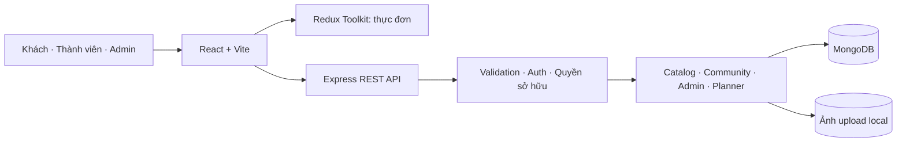
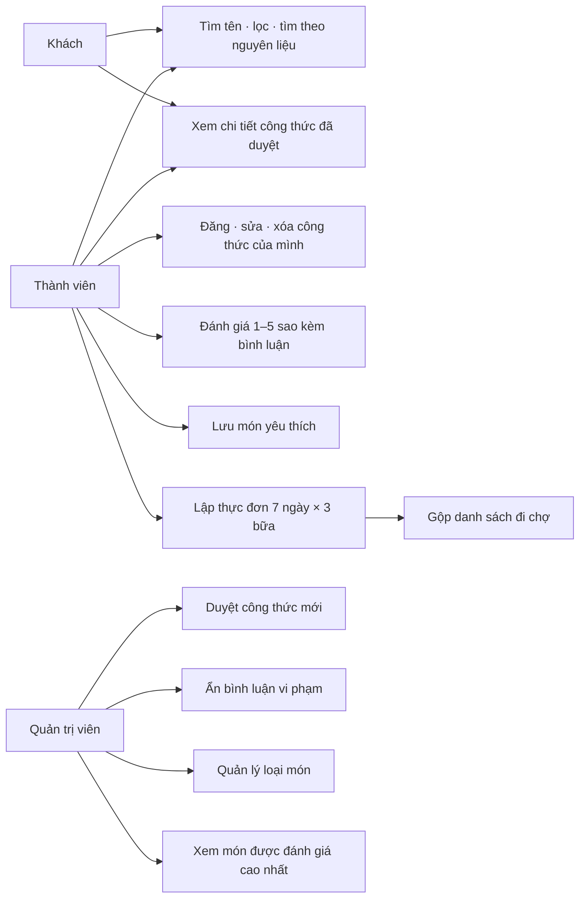
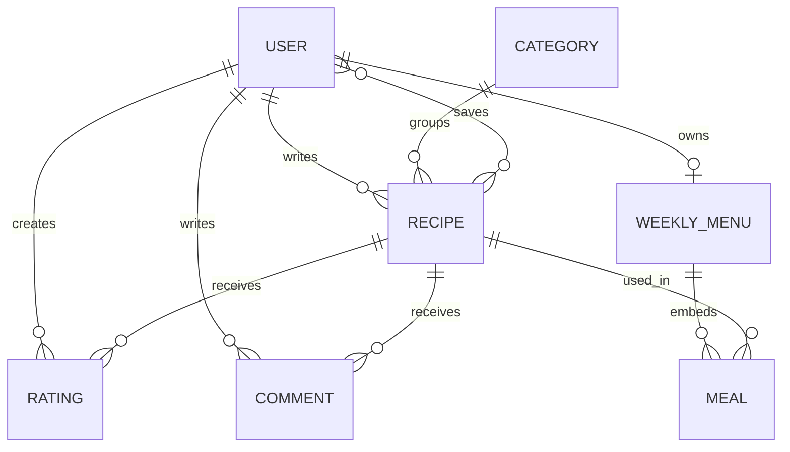
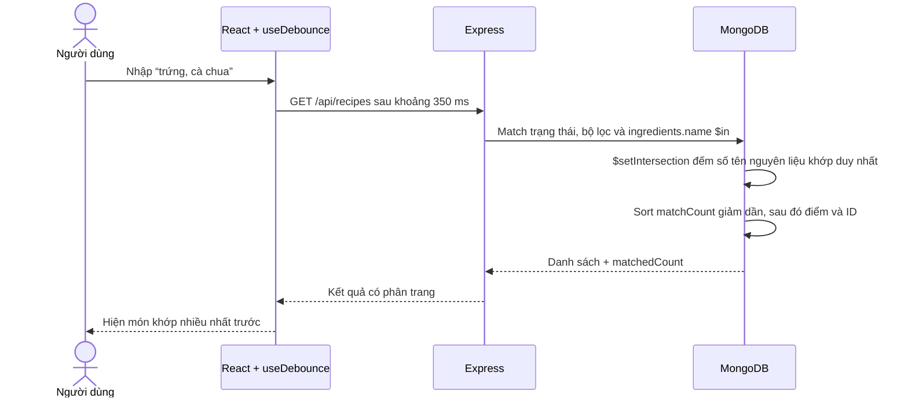

# Kiến trúc và sơ đồ

## Cấu trúc dự án

```text
bep-nha/
├── apps/
│   ├── api/
│   │   ├── src/
│   │   │   ├── app.js / server.js         # Middleware, router, khởi động
│   │   │   ├── config.js / db.js          # Biến môi trường và kết nối
│   │   │   ├── features/
│   │   │   │   ├── catalog/              # A · công thức, danh mục công khai
│   │   │   │   ├── auth/                 # B · tài khoản và xác thực
│   │   │   │   ├── community/            # B · đánh giá, bình luận
│   │   │   │   ├── admin/                # B · kiểm duyệt, danh mục, thống kê
│   │   │   │   └── planner/              # C · món đã lưu và thực đơn
│   │   │   ├── middleware/              # Xác thực, phân quyền, lỗi, upload
│   │   │   ├── models/                  # Schema MongoDB
│   │   │   └── utils/                   # Hàm gộp danh sách nguyên liệu
│   │   ├── test/                        # Unit test, integration test
│   │   └── uploads/                     # Ảnh tải lên khi chạy local
│   └── web/
│       ├── public/images/               # Ảnh mẫu được phép sử dụng
│       └── src/
│           ├── app/                     # Router, layout, store/provider
│           ├── features/                # catalog, auth, community, admin, planner
│           ├── shared/                  # UI chung, API client
│           └── styles/                  # Token và CSS nền
├── .github/workflows/check.yml          # Cài, lint, build, test trên PR
├── docker-compose.yml                   # MongoDB local
└── docs/                                # Tài liệu nhóm
```



## Chức năng theo vai trò



## Mô hình dữ liệu



| Dữ liệu | Quy tắc |
| --- | --- |
| `User` | Email duy nhất sau chuẩn hóa, mật khẩu băm, vai trò `member` hoặc `admin`. ID món yêu thích lưu trong `favorites`. |
| `Recipe` | Chứa mảng `ingredients` và `steps`, tham chiếu tác giả và loại món. Trạng thái `pending`, `approved`, `hidden`. Công thức mới hoặc sửa nội dung về `pending`. |
| `Rating`, `Comment` | Mỗi cặp công thức và thành viên tối đa một đánh giá, dùng unique compound index. API tạo sao và bình luận cùng một giao dịch. Ẩn bình luận chỉ thay đổi trạng thái bình luận. |
| `WeeklyMenu` | Mỗi thành viên có một bảng tuần đang dùng, tối đa 21 ô. Mỗi ô chỉ có một món và một số khẩu phần. Backend kiểm tra trùng `day + slot`. |
| `Category` | Tên và slug duy nhất. Khi có công thức tham chiếu, API báo lỗi nếu yêu cầu xóa loại món. |

Xóa công thức bằng trạng thái `hidden` để giữ tham chiếu lịch sử. Công thức ẩn biến mất khỏi khám phá, yêu thích và lần thêm mới vào thực đơn. Ô thực đơn cũ hiển thị «Món không còn khả dụng» và được bỏ qua khi tính danh sách đi chợ. Quyết định này giữ được chỗ trong thực đơn để thành viên chủ động chọn món thay thế.

## Luồng tìm theo nguyên liệu



Chuẩn hóa tên nguyên liệu thành Unicode NFC, bỏ khoảng trắng đầu/cuối, gộp khoảng trắng liên tiếp và đổi chữ thường. A dùng cùng quy tắc khi lưu công thức và tìm. Mong muốn ghép «trứng gà» với «trứng» cần bảng đồng nghĩa riêng, để ngoài MVP. Khi nhập tên món, escape ký tự regex trước khi tìm. Các lần gọi bị thay thế nên được hủy hoặc bỏ kết quả cũ để phản hồi đến sai thứ tự không ghi đè kết quả mới.

## Luồng kiểm duyệt, đánh giá và đi chợ

- **Kiểm duyệt.** Thành viên gửi công thức → API kiểm tra dữ liệu, ảnh và quyền sở hữu → `pending` → admin duyệt → `approved` → xuất hiện công khai. Chủ công thức xem bản chờ qua mục của mình. Chặn yêu cầu sửa/xóa từ tài khoản khác tại API.
- **Đánh giá.** Ghi rating và bình luận, cập nhật điểm trung bình và số lượt cho recipe trong một giao dịch MongoDB. Tạo unique index trước khi mở route ghi. Chuyển lỗi trùng khóa sang `409`. Ẩn bình luận giữ nguyên sao.
- **Đi chợ.** Redux Toolkit giữ 21 ô thực đơn và trạng thái lưu. Selector đọc nguyên liệu của từng món khả dụng, nhân `khẩu phần ô / khẩu phần gốc`, rồi dùng `reduce` cộng theo tên chuẩn hóa và đơn vị. `g` và `kg` đi thành hai dòng. C làm selector cho UI và có thể dùng API để trả dữ liệu nguyên liệu đã được phân quyền. Chỉ làm tròn khi hiển thị.
