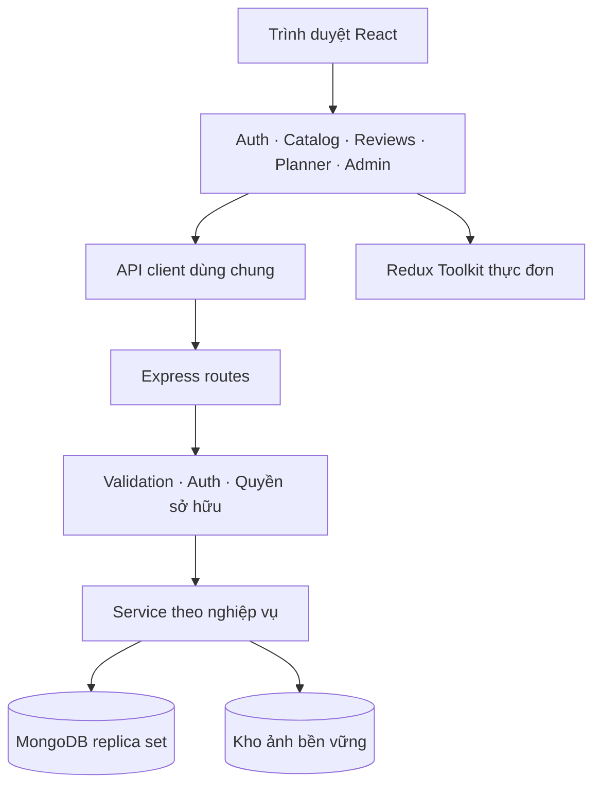
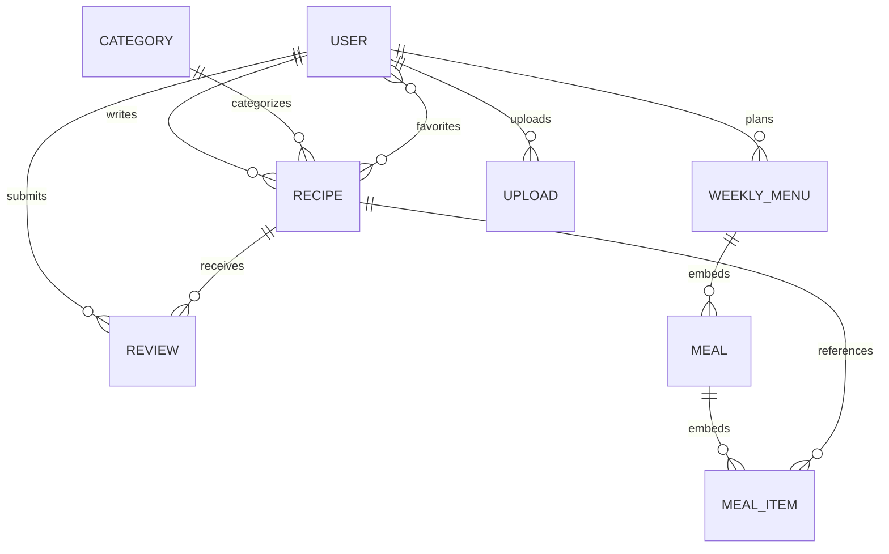
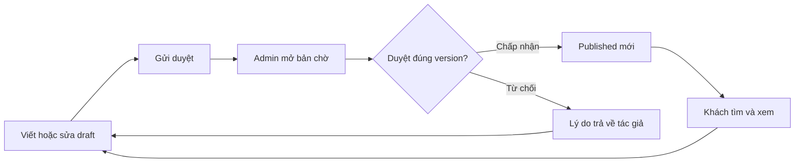
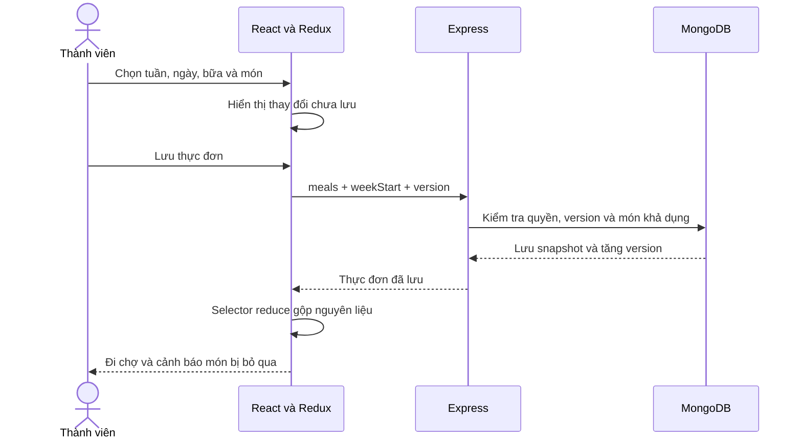
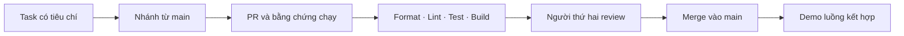

# Kế hoạch triển khai website sổ tay công thức nấu ăn

Tên dự án ........................................................

Ngày cập nhật 20/11/2026 · Phiên bản 1.3 · Lịch tiếp tục 21/11–15/12/2026.

## 1. Mục tiêu, phạm vi và cách sử dụng tài liệu

Xây dựng website sổ tay công thức nấu ăn cộng đồng theo Đề 3. Người dùng tìm món theo tên hoặc nguyên liệu đang có, chia sẻ công thức có ảnh, đánh giá món, lưu yêu thích, lập thực đơn tuần và tổng hợp danh sách đi chợ. Admin kiểm duyệt nội dung và quản lý loại món.

Tài liệu này là bản kế hoạch thống nhất để giao việc, triển khai và nghiệm thu. Dùng [bản kickoff](Ke%20hoạch.md) để giới thiệu với nhóm và [wireframe](DESIGN.md) để tham khảo bố cục. Khi đổi một quyết định, cập nhật bản này trong cùng PR với thay đổi liên quan.

Lịch tiếp tục gồm 25 ngày từ 21/11 đến 15/12/2026, dự kiến 2–3 giờ/người/ngày. Ngày 21/11, nhóm kiểm kê phần đã hoàn thành và nhận việc còn thiếu. Mục tiêu đủ chức năng bắt buộc vào 09/12. Ngày 10–12/12 dành cho triển khai và kiểm thử, ngày 13–15/12 dành cho dự phòng, báo cáo và bàn giao.

Mục tiêu bàn giao là bản MVP đủ yêu cầu, có đường dẫn chạy thử, dữ liệu demo và hướng dẫn khởi động lại. Phần cộng điểm được xếp sau nghiệm thu chức năng bắt buộc. Chỉ số đánh giá và ảnh dữ liệu mẫu cần ghi rõ là dữ liệu minh họa.

## 2. Điểm xuất phát và thay đổi cần thực hiện

Khi bắt đầu triển khai ngày 21/11/2026, repo có npm workspaces, React/Vite, Express, cấu hình MongoDB, các model sơ bộ, middleware xác thực và lỗi, một phép gộp nguyên liệu có unit test, workflow lint/build/test. Web hiện là trang khởi động. API đang có `/api/health`, server chưa kết nối MongoDB. Các thư mục tính năng đang là chỗ trống.

Thiết kế dưới đây là trạng thái đích. Những luồng nghiệp vụ, tên file và endpoint mô tả trong tài liệu cần được nhóm triển khai theo lịch.

| Phần | Quyết định |
| --- | --- |
| Repo và framework | Giữ một repo với `apps/web` và `apps/api`, React/Vite, Express/Mongoose, MongoDB. |
| Tổ chức module | Chia theo chức năng. Mỗi module có một chủ sở hữu và có thể có người phối hợp UI. |
| Rating và Comment | Gom thành `Review`, gồm sao, bình luận và trạng thái hiển thị bình luận. Giảm số bản ghi phải đồng bộ. |
| Recipe | Giữ bản đã duyệt tại `published`, bản đang sửa tại `draft`. Lần sửa không làm mất nội dung công khai đang dùng. |
| Xóa và kiểm duyệt | `deletedAt` ghi xóa của tác giả, `visibility` ghi quyết định của admin. Quy tắc xuất bản kiểm tra cả hai. |
| WeeklyMenu | Một người có nhiều tuần, khóa duy nhất `user + weekStart`. Mỗi bữa chứa danh sách món. |
| Nguyên liệu | Gợi ý từ danh sách tên mẫu, lưu tên chuẩn hóa và đơn vị chuẩn. Cho phép bổ sung tên mới. |
| TypeScript | Giữ JavaScript hiện tại để giảm chi phí chuyển đổi cho nhóm. Chốt dữ liệu qua schema validation ở server, mẫu JSON và kiểm thử API. |

Model cũ chỉ nên được thay thế sau khi kiểm tra có dữ liệu cần giữ hay không. Nếu đã có dữ liệu, người thay model chuẩn bị script chuyển đổi và bản sao trước khi chạy. Với repo chưa có dữ liệu nghiệp vụ, nhóm có thể thay model trực tiếp trong PR nền.

## 3. Phân công và quyền quyết định

| Người | Sở hữu chính | Phối hợp và trách nhiệm chung |
| --- | --- | --- |
| P1 — Trưởng nhóm | Auth, database bootstrap, review sao/bình luận, kiểm duyệt bình luận, bảng xếp hạng | Quản lý tích hợp, môi trường, phát hành. Dành 25–30% thời gian cho review và gỡ vướng. |
| P2 — Thành viên công thức | Catalog, tìm kiếm, chi tiết, đăng/sửa/xóa, upload, duyệt công thức và quản lý loại món | Dựng UI form và màn quản trị công thức theo component chung. Sở hữu mẫu dữ liệu công thức. |
| P3 — Thành viên giao diện và thực đơn | Layout, component chung, màn khám phá/đăng nhập, favorites, planner và shopping list | Sở hữu UI/Redux và API của thực đơn/yêu thích. P1 hỗ trợ phần server khó sau khi auth ổn định. |

Điền tên P1/P2/P3 trước ngày 1. Nếu P3 cần hỗ trợ Express, P1 cùng làm API thực đơn vào 04–05/12 và dành sẵn thời gian ở lịch đó. P2 và P1 tự dựng màn thuộc module của mình theo mẫu UI chung để cân bằng tải.

Chủ module là người giải thích dữ liệu và review ảnh hưởng, các thành viên vẫn có thể sửa module khác qua PR. Thay đổi contract, schema hoặc component dùng ở nhiều màn cần báo người đang dùng trước khi sửa. Mỗi PR có một người review, luân phiên P1 → P2 → P3 → P1. Riêng đổi quyền truy cập hoặc schema, P1 tham gia review.

## 4. Khung thư mục đích

```text
bep-nha/
├── package.json / package-lock.json       # Lệnh dùng chung, phiên bản thư viện
├── .env.example                          # Biến môi trường mẫu
├── docker-compose.yml                    # MongoDB replica set local
├── .github/workflows/check.yml           # Kiểm tra PR
├── apps/
│   ├── api/
│   │   ├── src/
│   │   │   ├── server.js                 # Kiểm tra config, nối DB, mở server
│   │   │   ├── app.js                    # Middleware và đăng ký router
│   │   │   ├── config.js / db.js
│   │   │   ├── middleware/               # Auth, role, validation, error
│   │   │   ├── models/
│   │   │   │   ├── User.js               # P1
│   │   │   │   ├── Review.js             # P1
│   │   │   │   ├── Recipe.js             # P2
│   │   │   │   ├── Category.js           # P2
│   │   │   │   ├── Upload.js             # P2
│   │   │   │   └── WeeklyMenu.js         # P3
│   │   │   ├── features/
│   │   │   │   ├── auth/                # P1
│   │   │   │   ├── reviews/              # P1, gồm route admin bình luận
│   │   │   │   ├── catalog/              # P2, gồm route duyệt và loại món
│   │   │   │   ├── uploads/              # P2
│   │   │   │   └── planner/              # P3, gồm yêu thích và đi chợ
│   │   │   └── scripts/seed.js           # Dữ liệu demo, chạy lặp an toàn
│   │   └── test/                        # Unit và integration theo module
│   └── web/
│       ├── public/images/
│       └── src/
│           ├── main.jsx
│           ├── app/
│           │   ├── router.jsx            # P3 ghép các route module
│           │   ├── providers.jsx         # P1 + P3, auth và Redux
│           │   └── store.js              # P3
│           ├── shared/
│           │   ├── api/client.js         # P1, gửi request và đọc lỗi
│           │   ├── ui/                   # P3, Button/Field/Dialog/Feedback
│           │   └── hooks/useDebounce.js
│           ├── features/
│           │   ├── auth/                # P1 logic, P3 form ban đầu
│           │   ├── catalog/              # P2 logic/form, P3 khám phá ban đầu
│           │   ├── reviews/              # P1
│           │   ├── planner/              # P3
│           │   └── admin/                # Layout P3, màn theo chủ nghiệp vụ
│           └── styles/                   # Token và CSS global tối thiểu
└── docs/KE-HOACH-TONG-THE-BEP-NHA.md       # Kế hoạch và quyết định chung
```

Trong một feature backend bắt đầu bằng `routes.js`, `schema.js`, `service.js`. Router nhận request, validation kiểm dữ liệu, service xử lý quyền và nghiệp vụ qua model. Frontend gom `pages/`, `components/`, `api.js` khi thực sự có nhiều file. Redux dùng cho planner theo đề bài. Trạng thái mở dialog hoặc nội dung một form đặt ở component. CSS Modules dùng cho style của module để hạn chế ảnh hưởng màn khác.

`RecipeCard` dùng chung trong feature catalog và được xuất qua `catalog/index.js`. Planner gọi interface công khai này, tránh import sâu vào file nội bộ. Component dùng chung nhận props và callback, không tự quyết định URL API hoặc quyền người dùng.



## 5. Dữ liệu và quy tắc nghiệp vụ

### 5.1. Bộ dữ liệu

| Model | Trường và ràng buộc chính |
| --- | --- |
| User | `name`, email chuẩn hóa duy nhất, `passwordHash`, `role`, `favorites[]`. API đăng ký luôn tạo member. |
| Recipe | `author`, `published`, `draft`, `draftVersion`, `moderationStatus`, `visibility`, `deletedAt`, `ratingSum`, `ratingCount`, `ratingAverage`. |
| RecipeContent | `title`, `summary`, `image`, `category`, `prepMinutes`, `cookMinutes`, `difficulty`, `servings`, `ingredients[]`, `steps[]`, `tags[]`. Dùng cùng schema cho draft/published. |
| Review | `recipe`, `user`, `stars` nguyên 1–5, `comment`, `commentStatus`, thời gian. Unique index `recipe + user`. |
| Category | `name`, `slug` duy nhất, icon tùy chọn. Chặn xóa nếu draft hoặc published còn tham chiếu. |
| Upload | Người upload, đường dẫn hoặc provider key, MIME đã xác minh, kích thước, thời gian tạo. Tối đa 5 MB, JPEG/PNG/WebP. Kiểm chữ ký file, đổi tên ngẫu nhiên và kiểm quyền sử dụng ảnh khi ghi công thức. |
| WeeklyMenu | `user`, `weekStart`, `version`, `meals[]`. Unique index `user + weekStart`. |

`weekStart` là chuỗi ngày thứ Hai dạng `YYYY-MM-DD`, tính theo múi giờ Asia/Bangkok. Mỗi meal gồm `day` 0–6, `slot` breakfast/lunch/dinner và `items[]`. Mỗi item có `recipeId`, `servings`, cùng snapshot tên món, ảnh, khẩu phần gốc, nguyên liệu và thời gian lấy snapshot. Mỗi ô tối đa 5 món, chặn trùng món trong cùng một ô, UI cho đổi khẩu phần món đã có.

Snapshot được lấy ở server khi thêm món từ công thức đã duyệt. Khi lưu lại món cũ, server giữ snapshot đã lưu và chỉ cập nhật khẩu phần hợp lệ. Thay công thức ở ô sẽ lấy snapshot mới. Điều này giúp công thức sửa ở thời điểm sau không âm thầm thay đổi danh sách đi chợ đã lập. Nếu admin ẩn hoặc tác giả xóa món, UI hiện cảnh báo và tên món từ snapshot, loại món đó khỏi phép tính đi chợ, nêu số món bị bỏ qua để người dùng thay món.



### 5.2. Công thức và duyệt

Tác giả lưu bản nháp, gửi duyệt khi đủ trường. Admin duyệt đúng `draftVersion` đang xem. Trong thao tác atomic, server kiểm tra version và chuyển draft sang published, tăng published version. Nếu tác giả vừa sửa, trả `409`, admin tải lại trước khi duyệt. Tác giả sửa món đã công khai sẽ tạo/cập nhật draft, published tiếp tục được dùng cho khách. Admin từ chối cần ghi lý do. Tác giả xem và gửi lại sau khi sửa.

`visibility` nhận visible/hidden. `moderationStatus` nhận draft/pending/approved/rejected. Một món xuất hiện công khai khi có published, visibility visible và deletedAt trống. Admin ẩn món áp dụng ngay, tái duyệt draft không tự bỏ trạng thái ẩn. Tác giả xóa đặt deletedAt, API sửa/gửi duyệt từ chối đối tượng đã xóa.



### 5.3. Tìm kiếm và nguyên liệu

Tìm tên hỗ trợ nhập không dấu bằng trường tìm kiếm chuẩn hóa riêng. Tên hiển thị giữ dấu tiếng Việt. Với nguyên liệu, dùng tên chuẩn hóa NFC, lowercase và khoảng trắng thống nhất, kết hợp danh sách gợi ý để giảm nhập nhiều cách. Bản đầu dùng gợi ý tên chính xác, quản lý đồng nghĩa mở rộng sau.

Server dùng `$in` lọc nguyên liệu trong published và Aggregation `$setIntersection` để đếm số tên khớp duy nhất. Thứ tự là số khớp giảm dần, điểm trung bình giảm dần, ID để ổn định phân trang. Loại món, độ khó và tổng phút sơ chế + nấu có thể lọc kết hợp. Tối đa 12 nguyên liệu/truy vấn, 48 kết quả/trang. Frontend debounce khoảng 350 ms, hủy hoặc bỏ phản hồi cũ khi người dùng đổi truy vấn.

Kết quả trả `matchedIngredients` và `missingIngredients`, UI ghi rõ khớp bao nhiêu và còn thiếu gì. Các gia vị cũng tính theo dữ liệu công thức. Giá trị “khớp” mô tả tên nguyên liệu, chưa xác nhận người dùng có đủ số lượng.

### 5.4. Đánh giá và bình luận

Mỗi thành viên đánh giá một lần cho mỗi món đã duyệt, bắt buộc bình luận cùng sao. Trong một transaction, tạo Review và cập nhật tổng sao, số lượt, trung bình trên Recipe. Unique index chống gửi trùng, transaction xử lý ghi đồng thời và retry lỗi tạm thời phù hợp. Lỗi trùng trả `409 REVIEW_ALREADY_EXISTS`. Admin ẩn nội dung bình luận, tổng sao vẫn giữ. Món xếp hạng dùng `ratingAverage DESC`, tiếp theo `ratingCount DESC`, chỉ lấy món công khai có lượt đánh giá.

### 5.5. Thực đơn và đi chợ

Redux giữ tuần đang chọn, meals, trạng thái tải/lưu/lỗi và thay đổi chưa lưu. API PUT gửi kèm version, server chỉ ghi khi version khớp rồi tăng version. Hai tab lưu từ cùng phiên bản thì lần sau nhận `409`, UI giữ thay đổi đang nhập và yêu cầu tải lại hoặc áp lại thay đổi để tránh ghi đè âm thầm.

Selector đi chợ nhân lượng theo `servings của item / servings gốc snapshot`, sau đó dùng reduce cộng cùng tên chuẩn hóa và đơn vị. Các đơn vị khác nhau hiển thị riêng. Danh sách chọn đơn vị dùng chung như g, kg, ml, l, quả, củ, muỗng cà phê, muỗng canh. “Vừa đủ” là loại lượng riêng, gom thành ghi chú, không tự chuyển thành số 0. Tính bằng độ chính xác đầy đủ và làm tròn ở giao diện. Checkbox đã mua giữ trong phiên UI, reset khi dữ liệu nguyên liệu của tuần thay đổi.



## 6. Giao diện và hành trình

Chọn nền kem `#F7F3E8`, surface `#FFFDF7`, chữ `#233328`, nút chính `#254C39`, nhấn `#A84325`. Font nội dung dùng Nunito, tiêu đề dùng Playfair Display, có fallback system/serif. Component dùng token chung, CSS theo module. Ảnh thẻ món tỉ lệ 4:3, nút tối thiểu 44 px, focus nhìn thấy được, form có label và lỗi tại trường.

| Trang | Nội dung và trạng thái cần làm |
| --- | --- |
| `/` | Ô tìm tên/nguyên liệu, gợi ý, bộ lọc, thẻ món, phân trang. Có loading, empty, lỗi thử lại. |
| `/cong-thuc/:id` | Ảnh, tác giả, thời gian, khẩu phần, nguyên liệu, bước, sao/bình luận, lưu món, thêm vào tuần. |
| `/dang-nhap`, `/dang-ky` | Validation, đang gửi, lỗi tài khoản. Quay lại đường dẫn nội bộ ban đầu sau đăng nhập. |
| `/cong-thuc-cua-toi` | Draft, chờ duyệt, bị từ chối kèm lý do, đã duyệt. Hành động xem/sửa/xóa. |
| `/cong-thuc/moi`, `/cong-thuc/:id/sua` | Form nguyên liệu và bước động, thứ tự ổn định, upload có tiến độ/lỗi, lưu nháp và gửi duyệt. |
| `/yeu-thich` | Thẻ món đã lưu, hủy lưu, trạng thái rỗng. |
| `/thuc-don` | Chọn tuần, 7 ngày × 3 bữa, nhiều món mỗi ô, khẩu phần, trạng thái lưu và danh sách đi chợ. |
| `/quan-tri/*` | Công thức chờ duyệt, bình luận, loại món và xếp hạng. Guard UI đi cùng quyền tại API. |

```text
KHÁM PHÁ — DESKTOP
┌─────────────────────────────────────────────────────┐
│ ........  Khám phá   Thực đơn   Yêu thích   Tài khoản │
│ Hôm nay nấu gì?                                      │
│ [Tên món / Nguyên liệu] [Từ khóa hoặc tên nguyên liệu]│
│ [Loại món] [Thời gian] [Độ khó] [Xóa lọc]             │
│ [Ảnh + tên món] [Ảnh + tên món] [Ảnh + tên món]       │
│ [Phút · sao]    [Phút · sao]    [Phút · sao]          │
│ [Khớp / thiếu] [Khớp / thiếu] [Khớp / thiếu]         │
└─────────────────────────────────────────────────────┘

CHI TIẾT — DESKTOP             THỰC ĐƠN — MOBILE
┌─────────────────────────┐   ┌────────────────────────┐
│ Ảnh và tên món          │   │ [Tuần 23/11 ← →]       │
│ [Lưu] [Thêm vào tuần]   │   │ Thứ Hai                │
│ Nguyên liệu │ Các bước │   │ Sáng [+ món]           │
│ Khẩu phần   │ và ảnh   │   │ Trưa [Món 1][Món 2][+] │
│             │         │   │ Tối  [+ món]           │
│ Sao và bình luận       │   │ ... các ngày tiếp theo │
└─────────────────────────┘   │ [Lưu thay đổi]         │
                              │ [Danh sách đi chợ]     │
                              └────────────────────────┘
```

Chốt ba màn khám phá, chi tiết và thực đơn ở desktop/mobile trong tuần đầu. Dùng ảnh thật của món tương ứng, ghi nguồn hoặc quyền dùng. Thử viewport 360, 768, 1280 px. Trên mobile thực đơn nhóm theo ngày để đọc được tên và số lượng món.

Khi khách bấm lưu/thêm món, ghi nhớ ý định và chuyển đăng nhập. Sau đăng nhập trở về món cũ, thực hiện lưu yêu thích hoặc mở lại hộp chọn bữa. Form bị lỗi mạng/upload giữ nội dung đã gõ. Rời form có thay đổi chưa lưu hiện xác nhận. Món bị ẩn hoặc xóa có thông báo rõ khi mở bằng URL cũ.

## 7. Hợp đồng API chốt cho nhóm

Base `/api`, JSON camelCase, ID công khai là `id`. Chi tiết published được làm phẳng khi trả về để UI dùng `recipe.title`. Endpoint của chủ món/admin trả rõ `draft`, `published`, version và trạng thái. Lỗi chung `{code, message, details?}`, details chỉ gồm lỗi trường được phép trả. Mã 400 dữ liệu sai, 401 cần đăng nhập, 403 thiếu quyền, 404 không tồn tại/không công khai, 409 xung đột, 413 ảnh quá lớn, 415 sai định dạng. Danh sách phân trang trả `{items,page,limit,total}`.

| Module | Endpoint cần xây | Chủ sở hữu |
| --- | --- | --- |
| Auth | POST `/auth/register`, `/auth/login`, `/auth/logout`; GET `/auth/me` | P1 |
| Công khai | GET `/recipes`, `/recipes/:id`, `/categories`, `/ingredients/suggestions` | P2 |
| Công thức cá nhân | GET `/me/recipes`, `/me/recipes/:id`; POST `/recipes`; PUT/DELETE `/recipes/:id`; POST `/recipes/:id/submit` | P2 |
| Upload | POST `/uploads` bằng multipart với trường `image` | P2 |
| Duyệt món | GET `/admin/recipes`, `/admin/recipes/:id`; POST `/admin/recipes/:id/review` với version/action/reason | P2 |
| Ẩn món | PATCH `/admin/recipes/:id/visibility` | P2 |
| Loại món | POST `/admin/categories`; PUT/DELETE `/admin/categories/:id` | P2 |
| Review | GET/POST `/recipes/:id/reviews`; GET `/admin/reviews`; PATCH `/admin/reviews/:id/comment-status` | P1 |
| Xếp hạng | GET `/admin/stats/top-recipes` | P1 |
| Yêu thích | GET `/me/favorites`; PUT/DELETE `/me/favorites/:recipeId` | P3 |
| Thực đơn | GET/PUT `/me/weekly-menu?weekStart=YYYY-MM-DD` | P3 |

Chọn phiên đăng nhập qua JWT có thời hạn trong cookie HttpOnly, SameSite Lax, Secure ở production. Web/API cùng origin qua proxy khi local và cùng host khi triển khai. API kiểm Origin của yêu cầu ghi và dùng CSRF token cho thao tác thay đổi dữ liệu. Logout xóa cookie. Bản đầu dùng phiên có thời hạn cố định, giao diện yêu cầu đăng nhập lại khi hết hạn. HTTP client dùng cách gửi cookie thống nhất. Quyết định này thay Bearer token trong tài liệu cũ và đòi hỏi sửa middleware auth sơ bộ.

Login trả `{user:{id,name,email,role}}`, lỗi tài khoản sai có cùng thông báo. Rate limit login/register. Quyền author lấy từ phiên, server bỏ qua role/author do client tự gửi. UI guard hỗ trợ trải nghiệm, API kiểm quyền ở mọi thao tác ghi.

Ngày 21/11 chốt fixture chung từ contract trong `docs/fixtures/`, gồm đăng nhập thành công/lỗi, danh sách món, chi tiết món và thực đơn một tuần. Khi đổi contract, thay fixture và bên tiêu thụ trong cùng PR hoặc chuyển tiếp tương thích.

## 8. Quy trình code, review và ghép

Mỗi task có người nhận, reviewer, mô tả đầu ra, phụ thuộc và bước nghiệm thu. Trạng thái board gồm Todo, Doing, Review, Done. Mỗi người giữ một task chính đang làm. Nhánh theo task như `feat/login-api`, `feat/recipe-search`, `feat/weekly-menu`. Mỗi nhánh xuất phát từ main mới nhất, mở PR sớm và ghép khi đủ điều kiện. Reviewer kiểm tra hành vi qua entry point thật.



Nhánh `integration/<moc>` dùng tạm khi nhiều PR phụ thuộc cần chạy chung. Sau khi thử, mọi sửa lỗi đưa về nhánh feature tương ứng, chạy lại check trên phiên bản mới nhất rồi ghép các PR vào main theo thứ tự. Ghi lại commit đã thử. Tránh tích lũy sửa lỗi chỉ tồn tại trên integration.

Mỗi ngày dành khoảng 10 phút xác định phụ thuộc, 90–120 phút triển khai, 20–30 phút review/demo và thời gian còn lại sửa lỗi. Lead ưu tiên gỡ phụ thuộc khi người khác bị chặn. Nếu một task quá một ngày, cắt theo đầu ra có thể thử, chẳng hạn API tìm kiếm trước, UI kết quả sau.

Tiêu chí Done gồm chạy đúng từ màn hình/API đã giao, quyền và validation đúng, có loading/empty/error cho UI liên quan, kiểm thử đúng rủi ro, build/check đạt và một người khác review. PR chỉ đổi style cần ảnh trước/sau và kiểm màn liên quan. Thay schema cần nêu dữ liệu cũ xử lý thế nào.

## 9. Bảng công việc từng ngày

Mỗi ngày có đầu ra chung để review và ghép vào main. Người hoàn thành sớm hỗ trợ task đang chặn nhóm.

| Ngày | P1 — Lead và Auth | P2 — Công thức | P3 — UI và Planner | Đầu ra nghiệm thu |
| --- | --- | --- | --- | --- |
| 1 · 21/11 | Rà phần đã làm, repo chung, Node và MongoDB | Rà schema công thức, chọn món seed | Chốt bố cục và chạy web trên máy nhóm | Cả ba chạy được bộ khung và biết phần còn thiếu |
| 2 · 22/11 | Nối DB, chốt auth và định dạng lỗi | Chốt schema Recipe và seed categories | Chốt mẫu thẻ món, login và fixture | Schema và dữ liệu mẫu thống nhất |
| 3 · 23/11 | Seed tài khoản, làm login API | API danh sách món đã duyệt và phân trang | Layout, router và form login dùng fixture | API login và danh sách chạy độc lập |
| 4 · 24/11 | Đăng ký, auth/me và logout | Tìm theo tên, API chi tiết | Nối login, danh sách và chi tiết qua API | Đăng nhập và mở món với dữ liệu thật |
| 5 · 25/11 | Kiểm quyền, hết phiên và CSRF | Thêm bộ lọc và truy vấn nguyên liệu | Nối bộ lọc và debounce | Tìm và lọc theo dữ liệu thật |
| 6 · 26/11 | Review luồng tài khoản và thống nhất seed | Kiểm thứ tự khớp nguyên liệu | Kiểm giao diện khám phá trên điện thoại | Mốc nền chung đạt |
| 7 · 27/11 | Chốt quyền chủ công thức và schema Review | API tạo bản nháp, validation | Thành phần form và trường động | Nháp lưu được, dữ liệu sai có phản hồi |
| 8 · 28/11 | Chuẩn bị test quyền và đánh giá | Upload ảnh và kiểm tệp | Hỗ trợ P2 dựng form đăng món | Upload kiểm đúng định dạng và dung lượng |
| 9 · 29/11 | API gửi đánh giá chống trùng | Nối form đăng món và gửi duyệt | Màn yêu thích dùng fixture | Đăng món vào hàng chờ, API đánh giá được thử |
| 10 · 30/11 | API đọc sao và bình luận | API duyệt/từ chối theo version | Nối API/UI yêu thích | Admin duyệt và khách thấy công thức |
| 11 · 01/12 | Nối sao và bình luận trên chi tiết | Màn món của tôi, chỉnh sửa bản nháp | Khung Redux và dữ liệu thực đơn tuần | Chỉnh draft giữ bản công khai |
| 12 · 02/12 | Kiểm đánh giá đồng thời | Xóa món, quyền sở hữu và ảnh lỗi | Dựng bảng 21 ô và hộp chọn món | Chặn ghi trùng và sửa/xóa sai quyền |
| 13 · 03/12 | Review nhóm auth và reviews | Review form, upload, duyệt và quyền | Thử lưu yêu thích và chọn món trên mobile | Mốc đóng góp và đánh giá đạt |
| 14 · 04/12 | Ẩn bình luận, hỗ trợ schema tuần | API quản lý loại món | API đọc/lưu thực đơn theo tuần | Dữ liệu thực đơn lưu và tải lại được |
| 15 · 05/12 | Bảng xếp hạng và review API thực đơn | Màn quản trị loại món và ẩn món | Nối chọn nhiều món, khẩu phần và snapshot | Admin quản lý được loại món, planner lưu món |
| 16 · 06/12 | Kiểm quyền các route admin | Kiểm món ẩn/xóa trong danh sách | Gộp nguyên liệu bằng reduce theo đơn vị | Danh sách đi chợ cho kết quả đúng |
| 17 · 07/12 | Review xung đột phiên bản thực đơn | Bù lỗi catalog và form | Xử lý lưu lỗi, xung đột và món ẩn | Mất mạng không làm mất dữ liệu đang nhập |
| 18 · 08/12 | Chuẩn bị cấu hình demo và secrets | Chuẩn bị lưu ảnh bền vững | Hoàn thiện bố cục thực đơn mobile | Chốt môi trường demo và chạy kiểm tra cơ bản |
| 19 · 09/12 | Demo quản trị và đánh giá | Demo khám phá, đăng và duyệt | Demo yêu thích, thực đơn và đi chợ | Đủ chức năng bắt buộc trên main |
| 20 · 10/12 | Triển khai demo, kiểm HTTPS, cookie và DB | Kiểm seed và upload trên bản demo | Thử các màn hình trên URL demo | Bản demo trực tuyến chạy được |
| 21 · 11/12 | Review chéo planner và quyền | Review chéo auth và đánh giá | Review chéo catalog và duyệt | Có danh sách lỗi kèm người xử lý |
| 22 · 12/12 | Kiểm sao lưu và phục hồi dữ liệu | Sửa lỗi form, ảnh và tìm kiếm | Sửa lỗi mobile, mạng và thực đơn | Bản tích hợp vượt các ca chính |
| 23 · 13/12 | Thử clone mới theo README | Chốt bằng chứng ca catalog | Chốt bằng chứng ca planner | Không còn lỗi chặn nghiệm thu |
| 24 · 14/12 | Chốt báo cáo theo kết quả thật | Chuẩn bị phần thuyết trình tìm kiếm | Chuẩn bị demo thực đơn và đi chợ | Chạy thử thuyết trình và bàn giao |
| 25 · 15/12 | Nghiệm thu cuối, tag và bàn giao | Demo công thức, xác nhận bằng chứng | Demo thực đơn, xác nhận giao diện | Nộp báo cáo và bàn giao dự án |

## 10. Kiểm thử và vận hành

| Mã | Ca nghiệm thu | Bằng chứng cần có |
| --- | --- | --- |
| T01 | Đăng ký, login đúng/sai, logout, phiên hết hạn | API test và chạy qua form |
| T02 | Người B sửa/xóa công thức người A, member gọi route admin | 403, dữ liệu không bị ghi |
| T03 | Tìm tên, bộ lọc và nhiều nguyên liệu kết hợp | Món khớp nhiều hơn đứng trước, món chưa duyệt, bị ẩn hoặc đã xóa không hiển thị |
| T04 | Form động, upload ảnh hợp lệ, file giả ảnh và quá 5 MB | File sai bị chặn phía server, nội dung form giữ được |
| T05 | Đăng/sửa draft và duyệt, hai bên cập nhật cùng lúc | Bản công khai chỉ đổi khi duyệt đúng version, 409 khi xung đột |
| T06 | Hai request review cùng user/món, hai user khác nhau | Một review/user/món, điểm trung bình và số lượt đúng |
| T07 | Ẩn bình luận, ẩn món, xóa loại món đang dùng | Nội dung công khai đúng, sao không đổi khi ẩn bình luận |
| T08 | Lưu yêu thích gọi lặp và xóa yêu thích | Không trùng ID, dữ liệu đúng người dùng |
| T09 | Hai tuần, 21 ô, nhiều món/bữa, tải lại trang | Đúng tuần/ngày/bữa/khẩu phần và giữ snapshot |
| T10 | Hai tab lưu cùng version thực đơn | Lần ghi cũ bị từ chối, UI giữ thay đổi để xử lý |
| T11 | Trùng nguyên liệu, khác đơn vị, vừa đủ, khẩu phần lẻ | Tổng chính xác, tách đơn vị, cảnh báo món thiếu khả dụng |
| T12 | 360/768/1280 px, bàn phím và mạng lỗi | Không che thao tác chính, có trạng thái và thử lại |
| T13 | Clone mới, seed, build, deploy và restart | README chạy được, DB và ảnh vẫn còn |

Unit test tập trung vào chuẩn hóa, tỷ lệ khẩu phần và phép gộp. Integration test dùng database riêng trên replica set cho giao dịch đánh giá, quyền sở hữu và xung đột version. Chạy lint, build và test trước khi ghép vào main. Seed demo chỉ tác động dữ liệu mẫu đã định danh.

Web và API triển khai cùng origin. Dùng MongoDB hỗ trợ replica set và kho ảnh bền vững, dự kiến Cloudinary. Kiểm tra quyền truy cập và chi phí trước khi chọn gói. Cấu hình nhạy cảm nằm trong biến môi trường. Server cần kiểm tra cấu hình, kết nối database trước khi báo sẵn sàng và ghi lỗi nội bộ ở server. Kiểm sao lưu và khôi phục vào 12/12. Nếu URL demo chưa chạy, ghi rõ trạng thái và bàn giao hướng dẫn chạy local.

## 11. Bàn giao hoàn thành

- Chạy T01–T13 và ghi bằng chứng. Hạng mục chưa đạt có người xử lý và lịch theo dõi.
- Gắn tag phát hành, xác minh README từ clone mới, cung cấp env mẫu và seed.
- Bàn giao mã nguồn, báo cáo, tài khoản demo và kịch bản trình diễn. Mỗi thành viên demo phần mình và review ít nhất một module khác.
- Ưu tiên xử lý lỗi bắt buộc vào 13–14/12. Cân nhắc phần cộng điểm khi các ca bắt buộc đã đạt.

## 12. Ghi nhận điều chỉnh

Phiên bản 1.3 để trống tên dự án và điều chỉnh lịch tiếp tục từ 21/11 đến 15/12/2026. Ngày 09/12 là mốc nội bộ cho chức năng bắt buộc. Nhóm dành sáu ngày cuối để kiểm thử, sửa lỗi, hoàn thiện báo cáo và tập demo.

